<picture>
  <source media="(prefers-color-scheme: dark)" srcset="assets/banner-oscuro.svg">
  
</picture>

## Herramientas

  <a href="https://radagora-labs.github.io/navestigio/"><picture>
    <source media="(prefers-color-scheme: dark)" srcset="assets/navestigio-oscuro.svg">
    
  </picture></a>
  <picture>
    <source media="(prefers-color-scheme: dark)" srcset="assets/vestigador-oscuro.svg">
    
  </picture>
  <picture>
    <source media="(prefers-color-scheme: dark)" srcset="assets/noctyra-oscuro.svg">
    
  </picture>

| | Qué resuelve | Estado |
| --- | --- | --- |
| **[Navestigio](https://radagora-labs.github.io/navestigio/)** | Reconstruye la actividad de navegación de un equipo (historial, descargas, sesiones) en una sola línea de tiempo. | Disponible, gratis |
| **Vestigador** | Consulta un indicador (IP, dominio, URL, hash) en varias fuentes de inteligencia y resume el veredicto. | Próximamente |
| **Noctyra** | Guía la investigación de un incidente: veredicto, preguntas abiertas, consultas sugeridas y plan de acción. | En desarrollo |

<picture>
  <source media="(prefers-color-scheme: dark)" srcset="assets/divisor-oscuro.svg">
  
</picture>

## Cómo trabajamos

- **Tu evidencia se queda contigo.** Las herramientas corren en tu equipo y no envían telemetría. La evidencia solo sale si tú lo decides, por ejemplo al consultar una fuente de inteligencia.
- **Lo que no está en la evidencia no se inventa.** Cada conclusión apunta a los eventos que la sustentan, y "no aparece en lo entregado" nunca se presenta como "no ocurrió".
- **Gratis para la comunidad, con licencia para organizaciones.** Quien investiga por su cuenta, estudia o enseña usa la versión comunitaria sin costo.
- **En español.** Escritas desde el trabajo diario de respuesta a incidentes en Latinoamérica.

<picture>
  <source media="(prefers-color-scheme: dark)" srcset="assets/divisor-oscuro.svg">
  
</picture>

## Seguridad

¿Encontraste una vulnerabilidad en alguna de nuestras herramientas? Repórtala en privado desde la pestaña **Security → Report a vulnerability** del repositorio correspondiente. No abras un issue público. Más detalles en nuestra [política de seguridad](https://github.com/Radagora-labs/.github/blob/main/SECURITY.md).

Radagora Labs · radar + ágora: detectar señales y ponerlas en común

